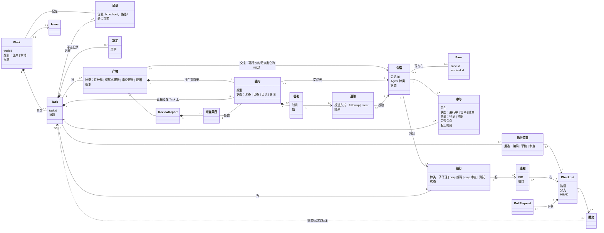

# 领域模型：开发者项目面板

2026-10-12 起草，交开发者确认。开发者指出面板有两种视角：**Work 视角**（一个 Work 有多个会话在做）与**会话视角**（一个会话会做多个 Work），关系已经混乱，要求先做一次 DDD 建模。本文只讲领域：有哪些东西、它们怎么关联、谁是真相源；不讲界面与实现。确认后，术语部分搬进面板包的 `CONTEXT.md`。

## 一、结论先行

1. **两个视角是同一个关系的两种看法**。会话与 Task 是多对多，而且随时间变化，所以中间有一个关联实体：**参与**（哪个会话、在什么时候、以什么角色做哪个 Task）。Work 视角是“按 Work 汇总参与”，会话视角是“按会话汇总参与”。
2. **会话、pane、运行是三样东西**：会话是一次 Agent 对话，以会话 id 认人；pane 是 herdr 里承载会话的终端，`/clear` 或重启后 pane 不变、会话换了；子代理、omp 编码与审查任务不是会话，是会话**派出的运行**，它们的提问通知派出它们的会话。
3. **Task 是一切挂靠的锚点**：产物、提问、参与、执行位置、提交都挂在 Task 上；只有少数东西挂在 Work 上（Issue、Work 级产物）。
4. **面板只登记三样东西**：参与、提问与答复（含通知）、编号；其余（Work 与 Task 的记录、决定、提交、会话状态）都从仓库、Git、herdr 现读，面板不是第二个真相源。

## 二、术语

### 工作

**Work**：一个有范围与授权的目标，分仓库 Work（记录入库）与本地 Work（记录在 `.local/agent/`）。
_Avoid_：项目、工单

**Task**：Work 里一个可单独执行与验收的切片；产物、提问、参与、执行位置都挂在它上面。
_Avoid_：任务卡、子任务

**记录**：Work 或 Task 的 README 等文字，是范围、授权、决定与当前状态的真相源。同一份记录可能在几个 checkout 里各有一份，其中一份是当前的，其余是副本。
_Avoid_：文档（文档专指下文的项目文档）

**决定**：开发者拍板后由 Agent 写进 Task 记录的一条文字；答复是它的来源，决定本身只认记录。
_Avoid_：结论、批复

**执行位置**：某个 Task 在某个 checkout 上做某种用途（编码、草稿、审查）的事实；一个 Task 可以有几个执行位置，一个 checkout 先后可以服务几个 Task。

### 会话

**会话**：一次 Agent 对话（Claude Code 或 omp），以会话 id 认人；它在某个 pane 里运行，有状态（工作、空闲、等确认、未知）。
_Avoid_：Agent（Agent 指程序种类）、终端、窗口

**pane**：herdr 里的一个终端；某一时刻至多承载一个会话，先后可以承载多个。
_Avoid_：会话、标签页

**Agent 种类**：会话由哪种程序驱动：Claude Code 或 omp；决定它支持哪些投递方式。

**参与**：某个会话在一段时间里以某个角色做某个 Task 的事实；来源是登记（会话经命令行声明，或命令行在领号、建 worktree、发布产物时顺手记下）或推断（从终端、提交等迹象猜出，标“推断”）。
_Avoid_：分配、绑定、关联

**焦点**：一个会话在它所有进行中的参与里，当前主要在做的那一个；至多一个。

**运行**：会话派出、在后台完成的一件事：子代理、omp 编码任务、omp 审查、测试或构建；有派出它的会话、所属 Task、状态，不是会话。
_Avoid_：子会话、后台会话

**进程**：机器上一个在跑的程序（开发服务、Playwright、omp），属于某个 checkout；由运行或会话起的才知道归属。

### 协作

**产物**：会话或运行交给开发者看的东西，挂在某个 Task（少数挂 Work）上，分四种：设计稿、讲解与报告、审查报告、证据；有版本。
_Avoid_：讲解页、Artifact（作为中文语境下的统称时）、附件

**提问**：要开发者拍板的一件事，挂在某个产物里或直接挂在 Task 上；记下提问者（会话），答复后通知它。
_Avoid_：问题单、待办

**答复**：开发者对一个提问的回答，只追加；最新的一份有效。
_Avoid_：回复、反馈

**通知**：答复之后告诉提问者会话的一次投递，有投递方式（followup：排在当前这一轮之后；steer：打断当前这一轮）与结果。
_Avoid_：消息、提醒

**审查条目**：审查报告里的一条发现；每条带一个“改、不改、要讨论”的处置提问。

**收件箱**：所有待开发者动手的东西的视图（未答的提问、未处置的审查条目、停下来等开发者的会话）；不是实体，不单独存。

### 现场

**checkout**：主工作区或一个 worktree；有路径、分支（或分离头）、HEAD、未提交改动。

**项目文档**：仓库里的长期真相：Spec、ADR、Proposal、规范、Skill、AGENTS、用户文档；按 checkout 有不同版本。
_Avoid_：产物、记录

## 三、类图

## 四、两个视角

两个视角都是查询，不是两套数据：

- **Work 视角**：Work → 它的 Task → 每个 Task 上的参与（哪些会话、什么角色、进行中还是暂停）、派出的运行、执行位置（哪些 checkout、各做什么用）、产物与未答的提问、相关提交。回答“这件事谁在做、做到哪、等我什么”。
- **会话视角**：会话 → 它的参与（按焦点、进行中、暂停、结束排）→ 每个参与指向的 Task 与 Work；它现在所在的 pane（终端）；它派出、还在跑的运行；它提出、还没答的提问；排队等投给它的通知。回答“这个会话在干什么、还管着哪些事、在等我什么”。

## 五、限界上下文

| 上下文 | 里面的东西 | 真相源 | 面板怎么拿 |
|---|---|---|---|
| 工作记录 | Work、Task、记录、决定 | 仓库与 `.local/agent/works/` 里的 README | 读文件；只有建 Work 与 Task 时由命令行写 |
| 代码现场 | checkout、分支、提交、执行位置 | Git | 只读 Git；执行位置由命令行登记，缺省时从目录名推断 |
| 会话 | 会话、pane、Agent 种类、状态 | herdr | 经 herdr 接口；面板有一层转换，herdr 的概念不直接漏进别的上下文 |
| 参与与运行 | 参与、焦点、运行、进程登记 | `.local/agent/` 的登记 | 命令行写、面板读；推断的另算、标出来 |
| 协作 | 产物、提问、答复、通知、审查条目 | `.local/agent/works/…` | 命令行发布产物、面板写答复与通知记录 |
| GitHub | Issue、PR | GitHub | 经 `gh`，第一版只读 |
| 访问 | 开发者、设备、配对 | `~/.config/nbdev/` | 面板自己管 |

上下文之间只用标识互相引用：协作里的提问记“Task 的 id”“提问者会话 id”，参与记“会话 id 与 Task 的 id”，不把对方的对象搬进来。

## 六、用场景检验

| 场景（今天真实发生的） | 模型里是什么 |
|---|---|
| 本会话（d02974de）先做 w00017 的 t80、t81，又做 w00022 的 t01 到 t03 | 一个会话、五段参与；t80 暂停，t03 是焦点 |
| 本会话派子代理写 t80 的 S1 到 S5 | 五个运行，派出者是本会话、为 t80；它们交来的报告归本会话 |
| t80 的 omp 审查（不在 herdr 里） | 一个运行（omp 审查），起了一个进程；审查报告是产物，C1 是审查条目，带一个处置提问 |
| k1 会话在主线 worktree 上先后做 t78、t79、t82、t83 | 一个会话、四段参与；同一个 checkout 先后是四个 Task 的执行位置 |
| t80 有三个 checkout：代码、草稿、审查 | 三个执行位置，用途不同；审查用的那个已删除，执行位置结束 |
| t80 评审板上的 8 个已答问题，与“settings.window 晋升？” | 前者是挂在产物里的提问，后者是直接挂在 Task 上的提问 |
| 子代理画稿时问的问题 | 提问者记派出它的会话（本会话），答复后通知本会话 |
| 一个 pane 里执行了 `/clear` | 新会话；旧会话的参与与提问不自动转过去，答复时提示“会话已更换” |
| w00017 的平台回顾页（不属于任何 Task） | 挂在 Work 上的产物 |
| stellaris-mcp 仓库里的会话 | 不在本仓库的 Work 里，会话视角里单列“别的仓库” |

## 七、要开发者确认的

1. **参与要不要“焦点”**：一个会话同时有几段进行中的参与时，标出当前主要在做的那一个（会话视角的标题、新产物默认挂到哪里都靠它）。建议要，至多一个。
2. **运行不是会话**：子代理、omp 编码与审查都算会话派出的运行，面板的会话列表里不出现它们，只在派出它的会话与所属 Task 下面出现；它们的提问通知派出它们的会话。
3. **提问者会话已经结束时**：答复后改通知这个 Task 上还在进行的其它参与会话；一个都没有就只留在收件箱，等下一个参与这个 Task 的会话来读。
4. **参与的来源**：只认登记的参与进 Work 视角的“谁在做”；推断的只在会话视角里以“推断”显示，不进统计。
5. **执行位置的用途属于“Task 在 checkout 上”这个关系**，不属于 checkout 本身；同一个 worktree 以后可以给别的 Task 用。
6. **决定只认记录**：答复转成决定由 Agent 写进 Task README，面板不直接写决定。
