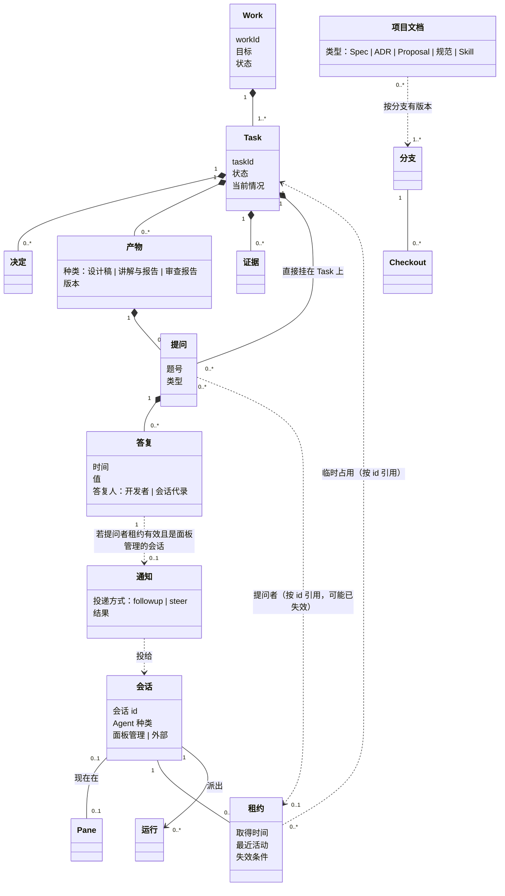
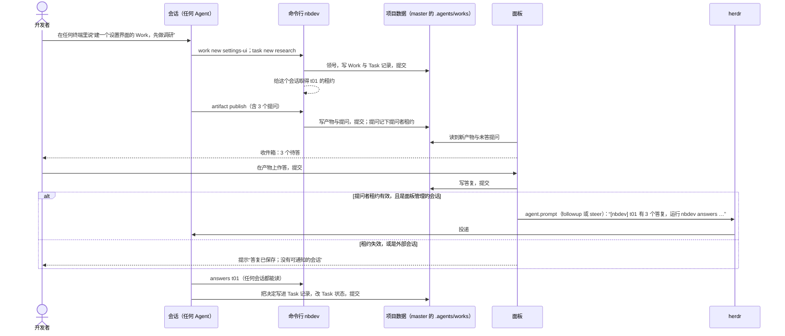

# 领域模型：开发者项目面板

2026-10-12 第二版，按开发者对第一版的意见重写；第八节的七件事开发者已于当天确认。第一版把“哪个会话在做哪个 Task”建成持久的“参与”，开发者指出这是本末倒置：

- **会话是临时的，项目数据是持久的**。会话只是推进 Work 的途径；一个 Work 现在由哪些会话在动，是临时数据。Task 的状态、产物、答复、证据是持久数据，任何会话都能读。
- **会话与 Task 不是强绑定**，而是类似占用、租约的临时关系。面板不必记住 Work、Task 绑定了哪个会话，只是在开发者和会话之间临时搭一条通道。
- **区分面板管理的会话与外部会话**：面板管理的会话（在 herdr 里）面板能主动通知回去；外部会话不能，但照样能读到持久化的答复。
- **不要本地 Work**：项目 Work 只有十几 MB，基本是文字与产物的 HTML，统一入库。
- **Work、Task、Docs、Spec 要统一管理**：现在散落在不同分支、不同 worktree。

本文只讲领域：有哪些东西、哪些持久、哪些临时、怎么关联。确认后，术语部分搬进面板包的 `CONTEXT.md`。

## 一、结论先行

1. **两层**：**项目数据**（持久，入库）与**运行时**（临时，不入库）。面板与命令行对项目数据是读写都走仓库；对运行时只在内存或 `.local/` 里记。
2. **Work 与 Task 的记录只放一处**：主工作区 `master` 上的 `.agents/works/`。实现分支只放代码、Spec 与文档的改动，不再带 Work 与 Task 的记录。这样不论有多少分支、多少 worktree，Work 和 Task 都只有一份，面板与任何会话读的都是同一份。（这一条改变了原规则“执行状态和证据只在实现 worktree 维护”，已确认并写进 [Work 规则](../../../README.md#记录只放主工作区)。）
3. **Spec 与文档跟着代码走**：它们和代码在同一个分支上改、一起合并，所以仍按分支有不同版本。“统一管理”靠面板的视图：默认看 `master` 的版本，旁边标出哪些分支正在改它、改了什么。
4. **Task 有持久的、机器可读的状态**；Work 有目标与状态。Work 视角就是“目标 + 每个 Task 的状态 + 待答的提问 + 最近的产物”，都从记录里读。
5. **会话与 Task 之间只有租约**：会话在某个 Task 上做事时（领号、发布产物、提问、读答复、改状态）由命令行顺手取得或续期，会话结束或久不活动就失效。租约只用来回答两件事：Work 视角里“现在有谁在动它”，以及答复之后“通知谁”。
6. **通道 = 提问上记下的提问者租约**：开发者答复后，答复先持久化；如果提问者是面板管理的会话、租约还有效，面板经 herdr 把一行指针消息投过去（followup 或 steer）；否则什么也不发，答复留在记录里，下一个读这个 Task 的会话自然看到。

## 二、哪些持久、哪些临时

| 东西 | 持久还是临时 | 放在哪里 | 谁写 |
|---|---|---|---|
| Work（目标、状态） | 持久 | `master` 的 `.agents/works/<workId>/README.md` | 会话经命令行或直接编辑；面板也能新建 |
| Task（状态、当前情况、决定） | 持久 | `.agents/works/<workId>/tasks/<taskId>/README.md` | 同上 |
| 产物（设计稿、讲解与报告、审查报告） | 持久 | `tasks/<taskId>/artifacts/<artifactId>/`（HTML 与它引用的小文件） | 会话 |
| 提问 | 持久 | 写在产物的 HTML 里（约定的标记），或写在 Task 记录里 | 会话 |
| 答复 | 持久 | `tasks/<taskId>/artifacts/<artifactId>/answers/`（只追加） | 开发者经面板；会话代录时标明 |
| 证据（验证结论、测量数值、精选截图） | 持久 | Task 记录与 `tasks/<taskId>/evidence/` | 会话 |
| Spec、ADR、Proposal、规范、Skill、用户文档 | 持久，按分支有版本 | 仓库各处，随代码分支 | 会话 |
| 会话 | 临时 | herdr（面板管理的）或别处（外部的） | herdr、Agent 程序 |
| 租约 | 临时 | 面板与命令行的运行时登记（`.local/agent/run/`） | 命令行顺手写 |
| 通知 | 临时（结果留一条运行日志） | 运行时登记 | 面板 |
| 运行（子代理、omp 编码与审查、测试） | 临时 | 运行时登记、进程 | 会话 |
| 能重新生成的原始输出（完整截图集、日志、测试原始输出、omp 会话目录） | 临时 | `.local/agent/` | 会话 |
| 设备与配对 | 面板自己的配置 | `~/.config/nbdev/` | 面板 |

## 三、术语

### 项目数据（持久）

**Work**：一个有目标、有范围与授权的事情；记录只在 `master` 的 `.agents/works/` 里，有状态。
_Avoid_：项目、工单、本地 Work（已取消）

**Task**：Work 里一个可单独执行与验收的切片；有持久的状态，产物、提问、证据都挂在它上面。
_Avoid_：任务卡、子任务

**Task 状态**：Task 记录 frontmatter 里机器可读的 `status`，取值见第八节；“有几个待答提问”这类是现算的，不存进状态。

**记录**：Work 与 Task 的 README，是目标、范围、授权、决定与当前情况的真相源；只有一份。
_Avoid_：文档、快照副本

**决定**：开发者拍板后由会话写进 Task 记录的一条文字；答复是它的来源，决定本身只认记录。

**产物**：会话交给开发者看的页面，属于某个 Task（少数属于 Work），分设计稿、讲解与报告、审查报告三种；有版本。
_Avoid_：讲解页、附件

**提问**：要开发者拍板的一件事，写在产物里或 Task 记录里；有提问者租约的引用（用来通知），但提问本身不依赖那个会话还在不在。
_Avoid_：问题单、待办

**答复**：开发者对一个提问的回答，持久、只追加，任何会话都能读。
_Avoid_：回复、反馈

**证据**：支撑 Task 结论、需要长期留存的东西：验证命令与结果的文字摘要、不可重现的测量数值、少量精选截图。能重新生成的原始输出不算证据。

**项目文档**：Spec、ADR、Proposal、规范、Skill、AGENTS、用户文档；随代码在分支上改，按分支有不同版本。

### 运行时（临时）

**会话**：一次 Agent 对话（Claude Code 或 omp），以会话 id 认人；推进 Work 的途径，不是 Work 的一部分。

**面板管理的会话**：在 herdr 里、面板能看到并能主动投递消息的会话。

**外部会话**：不在 herdr 里的会话（例如 `omp -p` 后台任务、别的编辑器里的 Agent）；能用命令行读写项目数据，但面板不能主动通知它。

**pane**：herdr 里承载会话的终端；`/clear` 或重启后 pane 不变、会话换了。

**租约**：某个会话正在某个 Task 上做事的临时事实；由命令行在会话做 Task 相关的操作时取得或续期，会话结束或久不活动就失效；不入库。
_Avoid_：参与、绑定、分配、所有者

**通知**：答复后经 herdr 投给提问者会话的一行指针消息，投递方式 followup 或 steer。
_Avoid_：消息、提醒

**运行**：会话派出、在后台完成的一件事：子代理、omp 编码任务、omp 审查、测试或构建；不是会话。

**收件箱**：所有待开发者动手的东西的视图：未答的提问、未处置的审查条目；不存。

## 四、类图

实线是持久数据内部的组成；虚线是运行时对项目数据的临时引用（只存 id，对方不知道它）。项目数据里没有任何一条线指向会话。

## 五、一个开发流程

## 六、两个视角

- **Work 视角**（持久为主）：Work 的目标与状态 → 每个 Task 的状态与当前情况 → 待答的提问、最近的产物、证据；旁边一小块“现在有谁在动”，来自有效的租约，会话结束就消失。
- **会话视角**（临时为主）：面板管理的会话列表（来自 herdr）→ 每个会话持有的租约（它现在在动哪些 Task）、它派出还在跑的运行、排队等投给它的通知；点进去是网页版的 herdr 终端。外部会话只在“谁在动”里出现（如果它通过命令行取得过租约），不能打开终端。

## 七、用场景检验

| 场景 | 模型里是什么 |
|---|---|
| 开发者随便开一个 Agent，让它建 Work | 会话经命令行领号、写记录、提交；面板不参与，之后读到 |
| 这个会话结束了，过两天另一个会话接着做 | 第一个会话的租约失效；Task 状态、产物、答复都在记录里，第二个会话读记录接上，取得新租约 |
| 开发者在面板上答复，提问的会话还开着 | 答复入库；面板经 herdr 投一行指针，开发者选 followup 或 steer |
| 开发者答复时，提问的会话已经关了 | 答复入库；面板提示没有可通知的会话；下一个会话 `answers` 读到 |
| omp 审查（`omp -p`）交来审查报告 | 外部会话派出的运行；报告是产物，入库；审查条目的处置是提问 |
| 一个会话同时在 t80 与 t03 上做事 | 两个租约；都有效时，Work 视角里两个 Task 都显示它在动 |
| `/clear` 后同一个 pane 里的新会话 | 新会话，没有旧租约；旧租约随旧会话失效 |
| w00017 有一个长期分支和几个 Task 分支 | 记录都在 `master`；分支只带代码与 Spec 改动；面板的文档视图标出哪些分支在改哪份 Spec |

## 八、开发者的决定（2026-10-12）

除第 2 件外都按推荐确认。规则已改：[Work 规则](../../../README.md)、[`.local/README.md`](../../../../../.local/README.md)、[测试规范](../../../../../docs/testing/README.md)、[仓库流程](../../../../../docs/standards/repository-workflow.md)、[design-review](../../../../skills/design-review/SKILL.md)。

1. **记录只放一处**：Work 与 Task 的记录（含产物、提问、答复、证据）只放主工作区 `master` 的 `.agents/works/`，实现分支不再带记录；会话在任何 worktree 里干活，都经命令行（或直接编辑主工作区里的文件）写记录、在 `master` 上路径限定提交。（备选的单独记录分支不采用。）现有长期分支（w00017 等）的记录迁移见 [t05](../t05-migrate-records/README.md)。
2. **面板能写仓库，先不限制写什么**：新建 Work 与 Task、写答复以及其它修改，都在 `master` 上路径限定地提交。推翻第一版“面板只读仓库”的约束。（原推荐只写三类文件，开发者改为先不限制。）
3. **答复入库**：答复以文件形式进 Git，任何会话、任何机器都能读。
4. **证据的边界**：入库的是验证结论的文字、不可重现的测量数值、少量精选截图（建议单张不超过约 300 KB、每个 Task 不超过约 5 MB，超出的转成 WebP 或缩小）；完整截图集、日志、测试原始输出等能重新生成的仍在 `.local/agent/`。
5. **取消本地 Work**：已写进规则的“仓库 Work 与本地 Work”两类改回只有一类；`.local/agent/` 只放能重新生成的运行时与原始输出。
6. **Task 状态的取值**：`planned`（计划中）、`active`（进行中）、`done`（已完成）、`shelved`（已搁置）四种，写在 Task 记录 frontmatter 的 `status` 里；“等开发者”是现算的（有未答提问），不单独作为状态。Work 取后三种，另在 README 开头有“目标”一节。
7. **租约的失效**：会话在 herdr 里消失即失效；外部会话或久不活动的，超过 24 小时没有任何 Task 相关操作即失效。租约只存在运行时登记里，不入库。
